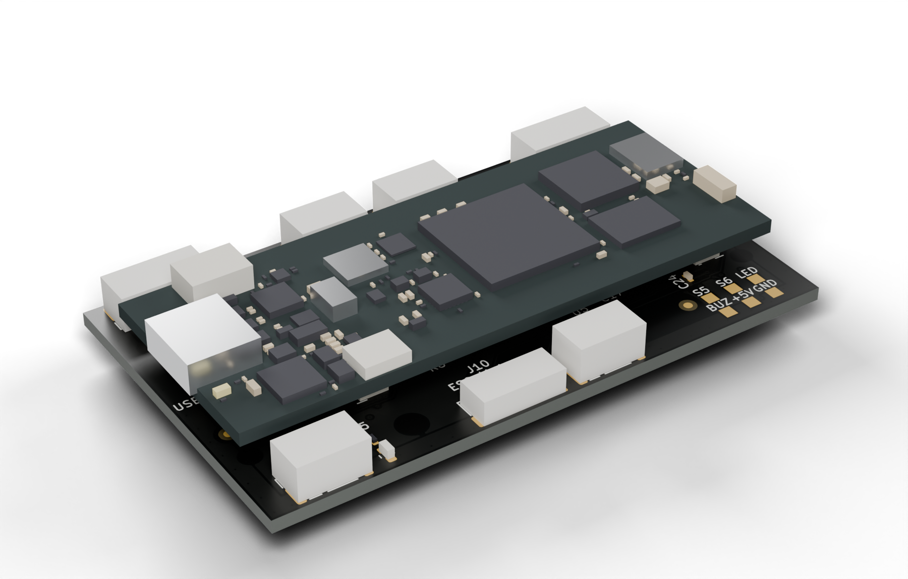
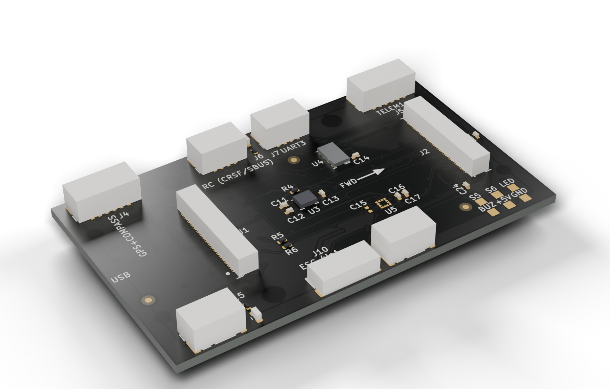

# Flight-controller carrier for Arduino® Portenta H7 (rev 0.3)

A 68 x 40 mm, 4-layer carrier that snaps onto the two 80-pin high-density connectors on the
bottom of an Arduino Portenta H7 and turns it into a flight controller.

**Status (2026-11-15): routed, DRC-clean, ERC-clean, JLCPCB fabrication and assembly files in `fab/`.**
KiCad DRC: 0 unconnected, 0 clearance or short errors. Left in `out/drc.rpt`: one copper-sliver
warning and two courtyard overlaps between J2 and the Portenta's own M2 holes (fixed by the H7's
geometry). It is an untested first build. All "Must verify before ordering" checks are done.
Two steps are still yours at order time: consign the DF40 sockets, and check the bottom-side
parts in JLCPCB's placement preview (item 8, mainly U6 and J11).

3D renders made headlessly from the board files (`scripts/render3d/run.sh`): every carrier part is drawn as a
block from KiCad's STEP export, the board faces show the real copper, solder mask and silkscreen, and the
Portenta H7 is reduced to blocks from Arduino's own 3D model (from the Portenta Breakout CAD bundle).

## What changed in rev 0.3 (design review, 2026-11-15)

A review by five parallel research/review tracks (hardware integration, firmware, circuit, market and
standards, layout/mechanics) before showing the board to Arduino. Fixed on the board:

- **ADC reference.** The module only pulls VREF+ (J2-71) up through ~100 kΩ / 100 nF and users measured
  it sagging from 3.1 V to ~2.6 V during conversions (battery/current readings up to ~19 % off). A TI
  **REF3125** 2.5 V series reference (U7, C24, C25) now drives J2-71; VREF- (J2-72) goes to GND. It works
  down to 2.55 V input (the module's 3V3 sits at 3.0 V on USB). For a Portenta C33 build leave U7/C25
  unfitted (J2-71 is an output there). Full scale: VBAT 27.5 V, current-sense 2.5 V.
- **ESC telemetry on its own UART.** J10-4 was wired to UART3_RX, which J7's device also drives. It now
  goes to PA8 = UART7_RX (J2-59), and M1 moved to PK1 (J2-60), still TIM1_CH1 beside M2 on TIM1_CH2.
  J7 keeps a full UART. (UART7 is the module's Bluetooth UART: keep Bluetooth off.)
- **LED strip that firmware can drive.** PH6 is TIM12, which has no DMA on the H7, so WS2812 LEDs could
  not work. The LED and S5 nets swapped (no copper moved): LED strip on PJ10 = TIM8_CH2 (DMA), S5 on
  PH6 = TIM12_CH1. S6 shares TIM8 with the LEDs (second LED string or GPIO while they run).
- **Sense inputs off the analog-only pads.** VBAT / current sense moved from PA0_C / PA1_C (no
  injection allowed, absolute max 4.0 V, unsupported by ArduPilot without a patch) to PA4 / PA6
  (J2-78 / J2-80). R10 went 1 k -> 10 k to limit current from an ESC output above 3.3 V.
- **Buck output capacitance.** 2 x 22 µF 0805 gave ~20 µF effective at 5.25 V; C26 / C27 bring it to
  4 x 22 µF as in TI's table for 5 V / 400 kHz. Values now say 25 V (the real part).
- **CAN terminator on by default** (the flight controller is a bus end): JP1 is a bridged solder jumper
  with a declared net tie; cut it to take the 120 Ω out.
- **Buzzer gate:** R13 10 k -> 100 k, so Q1 sees 3.27 V instead of 3.0 V.
- **Silkscreen:** forward arrows ("FWD", away from USB-C) beside the IMU on top and behind it on the
  bottom; a port map on the bottom behind each connector (the H7 hides most top labels); no
  "Portenta"/"Arduino" on the board (Arduino's trademark guide): board ID "FC CARRIER R0.3".
- **Checked and fine:** nothing under the H7 touches the module (tallest pair 0.9 + 1.0 mm in a 3.5 mm
  gap, from Arduino's STEP model); USB-C back-feeds the VIN pins through the module's Schottky, so +5V
  and the sensor rail are up on USB too (D2 blocks it from the buck); motors on TIM1/TIM3 do DShot and
  bidirectional DShot; J10 matches the Betaflight 8-pin ESC standard; GPS/TELEM/CAN/I2C match Pixhawk
  DS-009.

Deliberately left for rev 0.4 (need board space or a power-stage redesign): fuse + reverse-polarity
protection and a bulk input capacitor (the SMBJ26A clamp can exceed U1's 38 V); a higher-voltage buck
(8S); ESD arrays and a current-limited 5 V on the connectors; 10 V video regulator; second IMU / heater;
Pixhawk debug, POWER and 10-pin GPS ports; IMU caps closer to the supply pins; ideal diode instead of D2;
USB-FS pads (J1-26/28) for ROM DFU and ArduPilot without ULPI.

## What changed in rev 0.2

- **Re-routed from scratch** with a 0.16 mm routing target (JLCDFM rates >= 0.15 mm "good") on a
  0.127 mm DRC rule (what JLCPCB can make). JLCDFM-style warnings fell from ~300 to ~90.
- **Buck converter input loop:** C3 (100 nF) moved beside U1's VIN/PGND pins — the loop went
  from ~11 mm to 4 mm centre-to-centre (about 0.7 mm pad gap). This is the strongest emitter.
- **EMI:** a 2.5 mm GND ring on both outer layers stitched to the GND plane by 80 edge vias
  (largest gap 6.1 mm), an EMI layout check (`scripts/emi.py`) and a bench test procedure
  (`docs/emi_test.md`).
- **BOM cost:** $38.94 -> $25.81 per board in parts (10-board order), unique extended parts
  15 -> 11 (each costs a setup fee per order).
- **Sensors JLCPCB assembles normally:** U3 = TDK **ICM-45686** IMU, U4 = TE **MS5607** barometer.
  The previous DPS368 (and the IIM-42652 tried briefly) carry JLCPCB's "processing of this
  component is difficult" flag.
- **Placement verified against JLCPCB's own part footprints** — corrected placement file; it
  caught both LEDs, which would have been soldered backwards.
- 3 fiducials per side, board ID on the silkscreen, QR code re-placed and re-verified.
- J2-69 (one of the H7's four 3.3 V pins) is left open — no escape room next to the motor lines;
  the other three carry the 3.3 V load (about 130 mA; 0.9 A capacity).

## Ordering from JLCPCB

| Upload | File |
|---|---|
| Gerbers + drill | `fab/portenta_drone_fc_gerbers.zip` |
| BOM | `fab/jlcpcb_bom.csv` |
| Placement (CPL) | `fab/jlcpcb_cpl.csv` |

**PCB:** 4 layers, 68 x 40 mm, 1.6 mm, 1 oz outer / 0.5 oz inner, default stackup
(JLC04161H-7628). **Dark solder mask with white silkscreen** (the QR code prints its light
squares). ENIG recommended for the 0.4 mm-pitch sockets and LGA sensors (HASL lead-free works).
Smallest features: 0.127 mm track/space, 0.45–0.50 mm vias with 0.2 mm drill.

**Assembly:** Standard PCBA, both sides.
- **J1/J2 sockets (C3641790) have no JLCPCB stock: consign them.** JLCPCB's global-sourcing quote
  (2026-11-16) was $0.71 each but **145 business days** lead time (factory order), which would push
  prototypes to mid-2027. Mouser and Digi-Key list the same DF40HC(3.5)-80DS-0.4V(51) in stock at
  about $2.51 each (search snapshots of 2026-11-24, thousands of pieces; confirm on their pages):
  buy 2 per board plus 2 spares and ship them to JLCPCB through Parts Manager -> Consign parts.
  Nothing in JLCPCB's own stock substitutes (DF40C-80DS mates at 1.5 mm, too low). For production
  volumes, the $0.71 factory route works if ordered about 7 months ahead.
- R11, U5 and C15 (U5's capacitor) are deliberately not fitted. The list lives in `design.py` (`DNP`). Test pads, the CAN jumper JP1, fiducials and holes are
  not parts. The Portenta H7 itself is not in the order.
- In JLCPCB's placement preview, check the bottom-side polarised parts against "Must verify"
  item 8, especially **U6 and J11**. Those two are the only parts where the bottom-rotation
  conventions disagree.

## BOM and cost

Parts only (fabrication and assembly labour not included), JLCPCB prices of 2026-11-14/15,
`scripts/bom_cost.py` -> `fab/bom_cost.csv`:

| Boards | Rev 0.1 | Rev 0.3 | Per board (rev 0.3) |
|---|---|---|---|
| 5 | $221.91 | $157.31 | $31.46 |
| 10 | $389.36 | $272.11 | $27.21 |
| 30 | $1019.93 | $725.56 | $24.19 |

Rev 0.3 adds the REF3125 ADC reference ($0.88 plus one more extended-part setup fee) and four
capacitors over rev 0.2's $25.81. `scripts/bom_cost.py` now reads the current `fab/jlcpcb_bom.csv`.

| Part | Choice | Why |
|---|---|---|
| U1 buck, U2 LDO | TI LMR33630ADDAR, TI LP5907 | as before |
| U6 CAN | TI SN65HVD230DR | JLCPCB preferred part: no setup fee |
| U3 IMU | TDK ICM-45686 ($10.22) | pin-compatible with the ICM-42688-P (now $21.63, 7 in stock); 6.4 kHz ODR; not flagged |
| U4 baro | TE MS5607-02BA03 ($4.38) | the Pixhawk-family barometer; not flagged; MS5611 is a drop-in upgrade |
| L1 | KOHER MDA5030-6R8M ($0.49) | MPS MPL-AL5050-6R8 also fits the pads ($1.78, 19 in stock) |
| Q1, D3, D5, R2/R3 | 2N7002, red / white LEDs, 51k / 12k | JLCPCB basic parts (no setup fee); 51k/12k gives 5.25 V |

Further savings if wanted: XYECONN clones of the JST GH/SH connectors (about $2 per board), or
the TDK ICM-42670-P IMU ($2.15, but limited to 1.6 kHz output, flagged "difficult").

## Placement check against JLCPCB's footprints

JLCPCB places every part with its own (EasyEDA) footprint. For each LCSC part, that footprint was
fetched and fitted to ours by pad position (`scripts/jlc_corrections.json`), and
`scripts/jlc_place.py` writes the placement file from the board with those corrections (it first
checks that its geometry reproduces KiCad's pad positions exactly — error 0.0000 mm). Findings:

- JLCPCB's LED footprints number the **anode** as pad 1 (KiCad: cathode) — matched cathode to
  cathode, so the LEDs are not reversed.
- JST GH/SH connector origins differ by 0.06–0.25 mm; the microSD socket and SOT-23 parts are
  drawn rotated 180 degrees, SOIC-8 270 degrees, the DF40 sockets 90 degrees.
- JLCPCB's DF40 footprint numbers its pads in mirror order to ours. That does not matter: the
  socket is symmetric and each contact simply joins the pad under it to the H7 pin above it.

## DFM (JLCDFM)

`scripts/dfm.py` repeats JLCDFM's measurements with its limits (it measures rounded pads as
rectangles and also checks gaps within one net, as JLCDFM does) -> `out/dfm.rpt`.

- **Danger: 2**, both one SDC_D0 trace passing a corner of U2's +5V pad at 0.084 mm by the
  rectangle measure (KiCad's true-shape clearance is above 0.127 mm). No re-route found room.
- Warnings: 93 copper spacings between 0.10 and 0.15 mm (mostly tight escapes at the 0.4 mm-pitch
  sockets) and 62 vias with a 0.125 mm ring. Silkscreen: none.

## EMI

`scripts/emi.py` (layout review) and `docs/emi_test.md` (how to measure: near-field probes,
LISN, GPS C/N0 desense test). Current layout results (`out/emi.rpt`):

| Check | Result |
|---|---|
| Signal copper on the GND plane (In1) | 0 mm — OK |
| Fast signals within 1 mm of the edge | none — OK |
| GND stitching gap round the edge | 6.1 mm — OK |
| Buck switch-node copper | 19.0 mm² — OK |
| Buck input loop (centre-to-centre) | 4.0 mm (was 11) — at the limit |
| Fast-signal vias > 5 mm from a bypass cap | 25 of 37 — review |
| Fast-signal length over plane voids | up to 25 mm (In2 is cut by signals) — review |

Next-revision EMI items: add two or three 100 nF GND-to-+5V capacitors near the J1 SD/CAN escape
and the J2 motor escape; 22–33 ohm series resistors on the SDMMC clock and the DShot lines; keep
In2 free of signals (6 layers would allow it).

## Lessons taken from IMD Technologies, Grinn and Virtium

What their public material stresses, and what this board does about it:

| Practice | Here |
|---|---|
| Design for test, production tests (Grinn) | labelled test pads on every rail, SWD and NRST; fiducials; bring-up test list below |
| EMC pre-compliance before certification (Grinn) | `scripts/emi.py` each revision, `docs/emi_test.md` bench procedure |
| Signal/power integrity (Grinn) | GND ring + via fence, short buck loop, solid GND plane under the top layer |
| Industrial temperature, lifecycle discipline (Virtium) | every IC is rated -40 to +85 °C or wider; the board is limited to **-25 to +85 °C** by the JST GH/SH and microSD connectors (DF40 -35 to +85); all parts active, mainstream sources |
| Power-loss resilience (Virtium) | battery voltage on A0 so firmware can close the SD log before a brown-out |
| Cost-effective carrier + module, assembly options (IMDT) | jellybeans on basic parts, brand parts where they matter; U5 (with its C15) is a do-not-fit option (R11 is not fitted and must stay so, see "Must verify" item 4) |

Not done yet, worth doing before flying hardware: conformal coating, staking L1 and the microSD
socket against vibration, reverse-battery protection (there is only a TVS today), and ESD diodes
on the external connectors.

**Bring-up / production test**

1. Unpowered: no short between VBAT, +5V, +3V3, +3V3_SENS and GND.
2. 12 V, 100 mA current limit on VBAT: +5V_BUCK about 5.25 V, +5V about 4.9 V (after the SS34),
   +3V3_SENS 3.3 V; note the idle current.
3. H7 fitted: SWD connects; I2C scan finds the MS5607 at 0x76; IMU WHO_AM_I over SPI; microSD
   write/read; CAN loopback with a second node; UART loopbacks; PWM outputs on a scope;
   calibrate VBAT_SENSE; buzzer and both LEDs.

## Routing

4 layers: F.Cu / In1 GND plane / In2 +5V plane / B.Cu. 0.15 mm signals, 0.25 mm rails, 0.5 mm
VBAT/buck. Flow (all in `scripts/`): `stitch.py nopour` places plane vias on the empty board ->
Freerouting 1.9.0 (`tools/`, `route.py export/import`) -> `stitch.py narrow` (+5V pours and
bridges) -> `leftovers.py` + `patch.py` (grid router: `route`, `reroute`, `regroup` rip-up,
`prune`) and `route.py ... only:NETS` for local Freerouting passes -> `netcheck.py NET --bridge`
for split pours -> `scripts/post_route.sh` (values, EMI fixes, fiducials, vias, silkscreen,
checks, exports). `out/unrouted.kicad_pcb` is the placed, unrouted board; earlier routings are kept
in `out/` as `routed_v1_*` / `routed_v2_*`.

## Silkscreen

All text is 1.0 mm / 0.16 mm stroke, clear of pads, holes (vias included), parts and the edge.
Test pads carry their function; connectors their name and reference; the 2 x 3 pad block
(S5 S6 LED / BUZ +5V GND) has each label right above its pad. D3 and R14 have no label (no
room).
The bottom carries the board ID and a 10.9 mm QR code for https://github.com/dvirchakim
(`scripts/qr.py`), decode-checked from the finished board.

## Files

| File | What |
|---|---|
| `portenta_drone_fc.kicad_pro` | Open this in KiCad 7 |
| `portenta_drone_fc.kicad_sch` | Schematic (net-label style, one sheet) |
| `portenta_drone_fc.kicad_pcb` | Routed 4-layer board |
| `fc.pretty/`, `fc.kicad_sym` | Project footprint (DF40 socket) and symbols |
| `bom_placement.csv` | Parts, MPNs, side and XY (from `design.py`) |
| `fab/` | Gerber zip, JLCPCB BOM and CPL, `bom_cost.csv`, `placement_check.csv` |
| `out/` | Renders, `drc.rpt`, `dfm.rpt`, `emi.rpt` |
| `docs/` | Hirose DF40 drawing, EMI test procedure, `portenta_breakout_sockets.json` (Arduino's socket pads), `FC_Carrier_R0.3_review.html` (the rev 0.3 design review for the Arduino pitch, also published as a private page) |
| `scripts/design.py` | **Single source of truth** — parts, nets, placement |
| `scripts/regen_docs.py` | Rewrites schematic + BOM CSV from `design.py` without touching the routed board |
| `scripts/check_sockets.py` | Compares J1/J2 pad by pad with Arduino's Portenta Breakout and Hirose's land pattern / hatched area (exit 0 = match) |
| `scripts/erc.py` | ERC for the generated schematic plus schematic-vs-PCB parity, pad by pad (exit 0 = clean) |
| `scripts/power_copper.py` | Thermal vias in U1's exposed pad and power tracks widened as far as clearance allows |
| `scripts/render3d/` | Headless 3D renders of the board (STEP export -> blocks, layer textures, Blender) |
| `scripts/r03_renet.py`, `scripts/r03_rip.py` | The rev 0.3 review changes as applied to the routed board: net swaps, pad re-assignments, new footprints, then removal of the obsolete copper (run once; kept as the record) |
| `scripts/altium_pads.py` | Reads pads/nets from an Altium `.PcbDoc` with plain Python (made the reference JSON) |

`scripts/gen.py --force` would regenerate the board and discard the routing — do not use it now.

## Snap-on interface

- Carrier sockets J1/J2: **Hirose DF40HC(3.5)-80DS-0.4V(51)**, mating the H7's DF40C-80DP-0.4V(51).
  Board-to-board gap 3.5 mm.
- J1/J2 are 43.18 mm apart on the H7 centreline (17.14 mm and 60.32 mm from the USB edge).
- Pin 1, seen from the top with USB on the left: J1 pin 1 is in the USB-side row at the lower end;
  J2 pin 1 is in the outer row at the upper end. Same as Arduino's Portenta Breakout
  (`scripts/check_sockets.py`).
- Four M2 holes line up with the H7's corner holes — use 3.5 mm spacers so vibration is not
  carried by the connectors. At the J2 end use round spacers of 3 mm diameter or less.
- Four M3 holes on the standard 30.5 x 30.5 mm stack pattern.
- Under the H7 the top side carries only low parts (LGA sensors, 0402). Everything tall (buck,
  inductor, microSD, CAN transceiver) is on the bottom.

## Architecture

| Block | Parts | H7 signals |
|---|---|---|
| Power | 3-6S VBAT -> TVS -> LMR33630 buck 5.25 V (2 A continuous from 4-6S, ~1.5 A from 3S, 3 A peaks) -> SS34 -> +5V -> H7 VIN | J1-21/32/41/48 |
| Sensor rail | LP5907 3.3 V low-noise LDO from +5V | — |
| IMU | TDK ICM-45686, SPI | SPI1 CK/CIPO/COPI (PI1/PC2/PC3), CS PI0, INT GPIO2 (PD4) |
| Barometer | TE MS5607 (I2C, address 0x76) | I2C0 (PH8/PH7 = I2C3) |
| Magnetometer | LIS3MDL footprint, not fitted — use the GPS module's compass | I2C0 |
| Motors M1-M4 | 8-pin JST-SH 4-in-1 ESC connector (Betaflight standard order) | M1 PWM5 PK1 TIM1_CH1, M2 PWM4 PJ11 TIM1_CH2, M3 PWM1 PC6 TIM3_CH1, M4 PWM2 PC7 TIM3_CH2: no complementary channels, DMA on both timers, so DShot and bidirectional DShot work on all four |
| Aux S5, S6, LED strip | pads | LED strip PWM8 PJ10 = TIM8_CH2 (has DMA, so WS2812 works); S6 PWM6 PH15 = TIM8_CH3N (shares TIM8 with the LEDs: second LED string or GPIO while they run); S5 PWM9 PH6 = TIM12_CH1 (servo PWM) |
| Buzzer | 2N7002 low-side switch (R13 100k), pad | PWM7 PJ7 as a GPIO: active buzzer |
| Status / power LEDs | red (GPIO3) / white (+5V) | GPIO3 PD5 |
| Battery sense | VBAT 11:1 divider -> A6; ESC current (10k + 100 nF) -> A7; ADC VREF+ = 2.5 V from a TI REF3125 (U7) | A6 PA4 J2-78, A7 PA6 J2-80, VREF+ J2-71 (VREF- J2-72 to GND) |
| GPS + compass | JST-GH 6 (5V TX RX SCL SDA GND) | UART0 + I2C0 |
| Telemetry | JST-GH 6 with RTS/CTS | UART1 (USART1) |
| RC receiver | JST-GH 4 | UART2 (USART6) |
| Spare UART | JST-GH 4 | UART3 (UART8) |
| ESC telemetry | J10 pin 4 | PA8 = UART7_RX (J2-59), its own UART (the module's Bluetooth UART: keep Bluetooth off) |
| CAN | SN65HVD230 + JST-GH 4; 120 ohm terminator ON by default (bridged JP1: cut to remove) | CAN1 TX/RX (PH13/PB8) = FDCAN1 |
| I2C expansion | JST-GH 4 | I2C0 |
| microSD | Molex 104031-0811 | SDC (SDMMC2) |
| Debug | SWDIO/SWCLK/NRST/GND/3V3 pads (bottom) | J1-75/77/73 |

The +5V rail sits after the Schottky, on the same node as the H7's VIN, so the sensors and ports
run from USB on the bench and USB cannot back-feed the buck.

## Must verify before ordering

1. ~~J1/J2 pin-1 orientation vs the H7.~~ **Verified 2026-11-14** against Arduino's own
   Portenta Breakout (ASX00031) Altium layout, which uses the same DF40HC(3.5)-80DS-0.4V(51)
   sockets. All 160 pads land in the same place (0.000 mm difference, measured from J1 towards
   J2, seen from the top), with the same 0.2 x 0.7 mm pads and 43.18 mm spacing. All 57 H7 pins
   this board uses carry the same signal on Arduino's board: +5V on J1-21/32/41/48, +3V3 on
   J2-23/34/43, the GND pins, the UARTs, I2C0, CAN1, the SD card, SWD/reset, SPI1, PWM0-9 and
   A0/A1. Re-check after any footprint change: `scripts/check_sockets.py`.
2. ~~Socket keep-out.~~ **Checked 2026-11-15** against Hirose drawing EDC-337747-51-01 (`docs/`):
   - Pads match the recommended pattern: 0.2 x 0.7 mm at 0.4 mm pitch, 15.6 mm end to end,
     outer ends 3.78 mm apart and inner ends 2.38 mm apart.
   - Note 2's hatched area is each pad column extended inwards to 0.46 mm off the centre line
     (0.92 MAX). Only the same circuit may have copper there. J1 and J2 have no foreign copper
     there on F.Cu.
   - The `SOCKET_KEEPOUT` rule areas (2.2 x 18.6 mm, no F.Cu tracks, vias or pour) cover all of
     it, plus the 0.92 mm centre strip, so this is stricter than Hirose asks. The only F.Cu
     copper under a socket body is a CURR_SENSE track and a +5V pour edge at J2's short ends,
     beyond the last pad column and outside the hatched area.
   - `scripts/check_sockets.py` now checks this too. A track planted in the hatched area makes
     it fail.
3. **Sensor pinouts.** ICM-45686 checked pin by pin against TDK's datasheet. ~~MS5607~~
   **checked 2026-11-14** against TE's MS5607-02BA03 datasheet (06/2017):
   - Pins match (1 VDD, 2 PS, 3 GND, 4/5 CSB, 6 SDO, 7 SDA, 8 SCLK), and pin 1 sits in the same
     corner as TE's top view.
   - PS is tied high, which selects I2C. CSB is tied high rather than left open (TE says never
     leave it open), which gives address 0x76. SDO is unused in I2C mode.
   - Our pads (0.95 x 0.55 mm at ±1.075 mm) cover the package's 0.9 x 0.5 mm pads, slightly
     smaller than TE's suggested 1.1 x 0.6 mm at ±1.1 mm.
   - Two fixes. U4 is rotated 180° so no track or via passes between its pads (TE: "reserved
     area, do not route tracks between pads"), held by a `U4_KEEPOUT` rule area. The 100 nF cap
     C14 moved next to VDD (about 1 mm pad gap, was 4 mm), as TE asks.
4. ~~V_SDCARD (J1-72)~~ **Checked 2026-11-15** against Arduino's Portenta Breakout schematic
   (ASX00031 rev 1.3, sheets 1, 2 and 5):
   - On the Breakout, the H7's VSD pin (J1-72) is the card's only supply: VSD, then R1 (0 Ω),
     then card VDD, with 100 nF (C2) at the card. So VSD is an SD-card supply the H7 puts out.
   - This board powers the card from +3V3 instead (the H7's VCC output, J2-23/34/43) and leaves
     VSD open. That is safe and works whether or not firmware turns VSD on. The card can't be
     power-cycled by software, which a drone logger doesn't need.
   - **Never fit R11.** It would tie the H7's VSD output straight to +3V3, putting two
     regulators in parallel. It is not a way to switch the card to VSD. (The earlier note that
     this matched Arduino's carriers was wrong.)
   - C21 (100 nF) and C22 (10 µF) sit about 15 mm from the card's VDD pin, at the far end of the
     socket. Arduino puts its 100 nF at the card, so **C23 (100 nF, added 2026-11-15)** now does
     the same. It is on the top side at (66.9, 21.1), 0.5 mm from the +3V3 via that drops
     straight to J11-4, about 3 mm of copper in all. Nothing can go beside the pin on the bottom,
     because the card slides in under the board there.
5. ~~microSD pads~~ **Checked 2026-11-14** against Molex drawing SD-104031-001 (recommended PCB
   layout, ±0.05 mm). Our footprint is Molex's layout turned 180°, which is fine.
   - **Signal pads:** sizes and positions match (7 × 0.85 and 1 × 0.75 mm, 1.1 mm pitch). Contact
     No.1 = T1 (DAT2) is the one 3.105 mm from the centre on the card-detect side. Nets match the
     microSD pin map: 1 D2, 2 D3, 3 CMD, 4 VDD, 5 CLK, 6 VSS, 7 D0, 8 D1.
   - **Card-detect pads 9/10 and shell pads G1–G4 (our pad 11):** sizes and offsets from Molex's
     product line all match. Card detect is unused: pad 9 is open and pad 10 is on GND, which is
     harmless.
   - **Slot:** it opens towards the right-hand board edge, about 3.3 mm in from the edge, under
     the board. The path is clear of parts, but the card is pushed with a fingernail.
6. ~~M3 nuts vs the H7 edge~~ **Checked 2026-11-15.** The four M3 holes (30.5 mm pattern) are
   2.55 mm outside the H7's long edges. The H7 covers x 0.98–67.02, y 7.30–32.70, and its
   underside is 3.5 mm above the carrier.
   - On both sides, the nearest part courtyard is at least 3.9 mm from each hole's centre. So
     M3 hex nuts, hex standoffs (5.5 mm across flats, 6.35 mm across corners) and rubber
     grommets up to about 7.5 mm across all sit flat.
   - **Top side:** hardware reaches up to 0.65 mm under the H7's edge, so everything on top,
     including the screw tip, must stay **under 3.5 mm tall**. A standard M3 nut (2.4 mm) or a
     thin one (1.8 mm) is fine. A standoff going up is not: it would hit the H7.
   - So the carrier is the top board of a stack: standoffs go below it only.
7. ~~Schematic ERC~~ **Checked 2026-11-15** with `scripts/erc.py`. KiCad 7's command line has no
   ERC, and the GUI would pop windows.
   - The generated schematic only has passive pins and labels on pin ends, so the ERC checks
     that can fire on it are checked directly: pins not connected, dangling labels or flags,
     single-pin nets, duplicate references, and symbols that differ from `fc.kicad_sym`.
   - The script also compares every pad's net, value, footprint and schematic link with the PCB.
   - **Result: 0 violations.** 75 symbols, 376 pins, 60 nets and 115 no-connect flags, and
     the schematic and PCB agree pad for pad. A planted fault (one missing no-connect flag and
     one renamed label) is caught.
   - The check found that U4 and C14 had lost their schematic link, which is now fixed, and
     `swap_fp.py` now keeps the link.
   - IC pins left open, reviewed by hand: U1 PG, U2 NC, U3 RESV and INT2, U4 SDO (I2C mode),
     U5 INT and DRDY (U5 not fitted), and U6 VREF. All are allowed open by their datasheets.
8. **Bottom-side rotations: confirm in JLCPCB's preview.** The CPL uses
   rotation = 180 − KiCad rotation + JLC footprint offset, viewed from the bottom.
   - The only report from someone who actually looked at JLCPCB's preview with a bottom part at
     90° (kicad-jlcpcb-tools issue #159) matches this rule. The opposite rule (KiCad − 180)
     comes from a 2025 report whose preview "looked messed up".
   - For every bottom part except **U6** (SOIC-8, offset 270) and **J11** (microSD, KiCad
     rotation 90), all the candidate rules give the same answer, so only those two can be wrong.
   - In the preview, described in top-view terms (left = battery-pad edge, right = microSD
     edge, "J5 edge" = y 0):
     - **U1, U2, U6:** pin 1 is at the corner nearest the left edge and away from the J5 edge.
     - **Q1:** gate (pin 1) on the left, drain alone towards the J5 edge.
     - **D1, D2, D4:** cathode band towards the left edge.
     - **J11:** card slot opening towards the right edge.
     - If U6 or J11 shows 180° off, add 180 to that line of `fab/jlcpcb_cpl.csv`.
9. ~~Power stage hand review~~ **Done 2026-11-15**, against TI's LMR33630 layout guidance.
   - **Schematic:** pinout, VCC 1 µF, BOOT 100 nF and the EN pull-up are right. FB 51k/12k
     gives 5.25 V, about 4.85 V after D2, inside the H7's 4.1–6 V.
   - **Input caps:** the 100 nF hot-loop cap C3 sits 1.9 mm from VIN/PGND. The 10 µF caps C1/C2
     are about 6 mm away through the inner layer, which is acceptable at 400 kHz.
   - **Fixed:**
     - U1's exposed pad had **no thermal vias**. It now has 4 GND vias, 0.2 mm drill, into the
       In1 ground plane. The top row would hit the inner-layer battery track.
     - Power tracks were 0.5 mm and are now widened wherever clearance allows, checked against
       the exact pad outlines (`scripts/power_copper.py`):
       - switch node 0.65 mm (limited by U1's exposed-pad corner; a GND via was moved 0.45 mm to
         make room)
       - buck output 0.81 mm average
       - +5V through D2 0.92 mm
       - battery feed 0.9 mm on the bottom and 0.8 mm on the inner main path. Inner tracks are
         capped at 0.8 mm, because wider ones leave slivers in the +5V plane.
       - The EN and battery-sense branches stay at 0.5 mm, since they carry almost no current.
   - **Rating: 5 V at 2 A continuous from 4–6S, about 1.5 A from 3S, 3 A peaks** (the README
     used to say 3 A).
     - D2 (SS34, SMA) drops about 0.45 V and dissipates about 0.9 W at 2 A.
     - The switch node (0.65 mm, 1 oz outer) carries about 2.4 A for a 20 °C rise.
     - The weakest link is the 0.8 mm inner battery track (half-ounce copper). At 2 A out it
       carries about 0.8 A from 6S but about 1.2 A from a flat 3S pack, so 3S is derated.
     - For more current, use a bigger Schottky or an ideal-diode controller, and 1 oz inner
       copper, in the next revision.
   - TVS D1 (SMBJ26A) clamps at up to 42 V at its full pulse current, above U1's 38 V absolute
     maximum. The input ceramics absorb the energy of normal spikes, and a lower TVS would
     conduct on a full 6S pack (25.2 V), so this is the usual trade-off. It is not fixed.
   - **Rip-up routes:** UART1 and M1–M4 are DRC-clean and fine at their speeds.
     - UART1 runs 58 mm on In2 (the +5V plane), which cuts slots in the bottom layer's
       reference plane.
     - The motor lines cross 4–5.5 mm of plane gaps each (11–14 % of their length), which is
       harmless at ESC/DShot speeds.
     - The real cost is the SD-card lines. SDC_CLK runs 20 mm over gaps. That is in the
       next-revision EMI list (move UART1 off In2, then re-route the SD bus over solid plane).

## Firmware note

No ArduPilot, PX4, Betaflight or INAV build exists for the Portenta H7 (checked 2026-11-15). ArduPilot
is the realistic target: the STM32H747 is an STM32H757 without the crypto block, and ArduPilot already
runs the H757 (CubePilot Cube Orange+). Estimate: 8-12 person-weeks to a flying prototype with logging.
What an ArduPilot hwdef for this board needs:
- **Clock:** 25 MHz oscillator in HSE-bypass mode, enabled by PH1 (drive PH1 high before clock init).
- **Supply mode:** "SMPS 1.8 V supplies LDO" (ArduPilot offers SMPS, bypass or LDO only: a small patch).
- **PMIC:** NXP PF1550 on I2C1 (PB6/PB7) at 0x08. Simplest is to keep Arduino's MCUboot bootloader
  (application at 0x08040000, `FLASH_RESERVE_START_KB 256`), which already sets up the PMIC.
- **USB:** the USB-C port is high-speed through a USB3320 ULPI PHY, which ArduPilot doesn't support
  yet; use the telemetry UART or add ULPI support.
- **Pins:** "SPI1" is the MCU's SPI2 (AF5); ESC telemetry is UART7 RX on PA8; UART1's RTS/CTS (PI14/PI15)
  are not USART1's hardware flow-control pins, so use ArduPilot's GPIO flow control; leave PC2/PC3's
  analog switches open (J2-74/76/77/79 unconnected) and don't wire SWO (PB3 is SD D2).
- **M4 core:** leave it halted.
Drivers: ICM-45686 (Invensense v3 family), MS5607 (MS56xx). Recovery: Arduino double-tap DFU over
USB-C, or the SWD pads.
